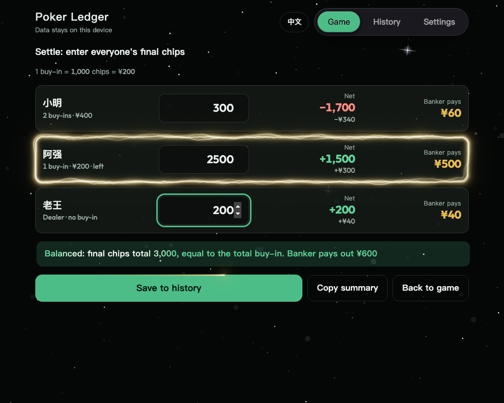
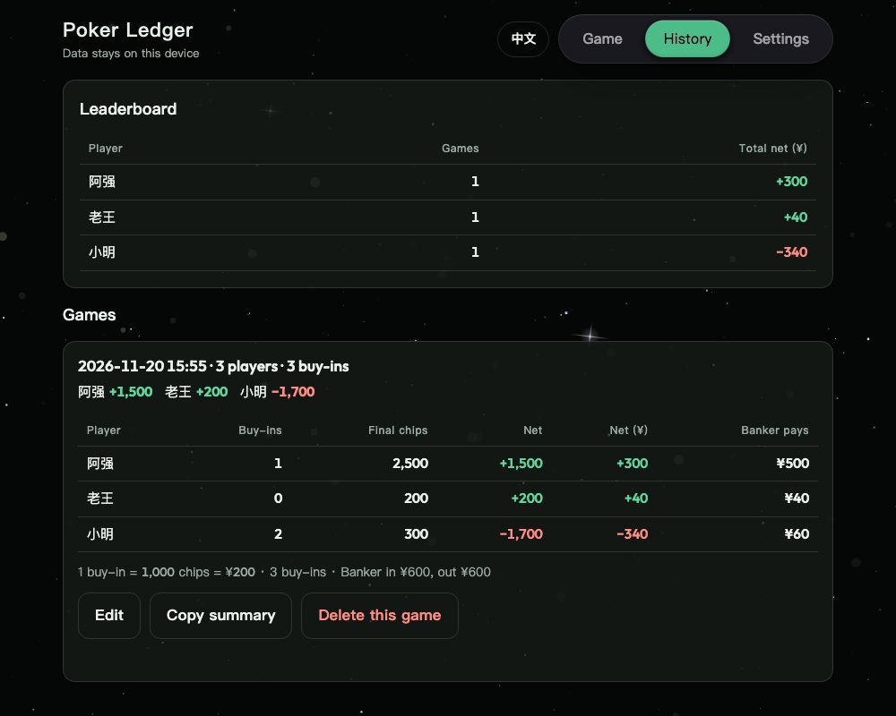

# Poker Ledger · 德州记分板

A scoreboard for home Texas Hold'em nights. Track everyone's buy-ins during the game, enter final chips at the end, and it tells you each player's net result and how much the banker pays each person.

**Try it: https://daniel2-ux.github.io/poker-ledger/** (no sign-up, no install; add it to your tablet's home screen)



## What it does

- **Buy-ins**: everyone starts with 1 buy-in; tap `+1` whenever someone rebuys.
- **Settlement**: enter final chips and get each player's net (in chips and money) and the amount the banker pays out.
- **Chip check**: warns you when the final chips don't add up to the total bought in.
- **Early leavers**: record someone's chips when they leave, so they are already filled in at the end.
- **Dealer**: a dealer who only deals sits at 0 buy-ins and still gets paid for the tips they collect.
- **History**: every game is kept, with a running leaderboard. Saved games can be edited.
- **Settings**: chips per buy-in, money per buy-in and the currency symbol (¥ $ € £ or your own) are adjustable.
- **Share**: copy the settlement as text for your group chat.
- **中文 / English**: switch with one tap.

Data stays in your browser (`localStorage`). Nothing is uploaded. Export/import a backup from Settings.

| During the game | History |
| --- | --- |
|  |  |

## How the maths works

The banker collects the money for every buy-in up front, so at the end:

- net chips = final chips − buy-ins × chips per buy-in
- banker pays = final chips ÷ chips per buy-in × money per buy-in

## 中文说明

朋友局德州扑克记分板：牌局中记录每个人买了几手，结束时填最终积分，自动算出每个人的净利润和 Banker 应转的金额。支持提前离场、只发牌的 Dealer（0 手）、历史记录与累计输赢榜、修改已保存的记录、复制结算文字、中英文切换。数据只保存在本机浏览器，不上传。

直接打开 https://daniel2-ux.github.io/poker-ledger/ 即可使用，可以添加到平板桌面。

## Run it yourself

```sh
npm install
npm run dev      # local development
npm run build    # static files in dist/, host them anywhere
```

Built with React, Vite, [Motion](https://motion.dev) and components from [React Bits](https://reactbits.dev).

## License

[MIT](LICENSE)
